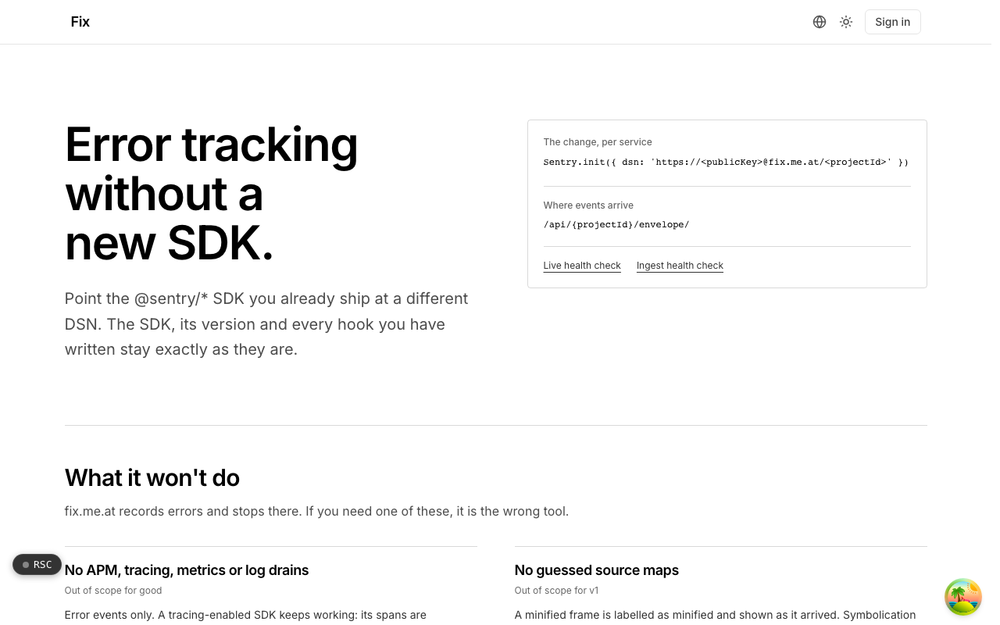

  <picture>
    <source media="(prefers-color-scheme: dark)" srcset=".github/assets/hero-dark.png">
    
  </picture>

# fix.me.at

Error tracking without a new SDK.

Fix is error tracking with a Sentry-SDK-compatible ingest endpoint. Point the `@sentry/*` SDK you already ship at a different DSN, and the SDK, its version and every hook you have written stay exactly as they are. Errors are grouped into issues, ingest is storm-capped, and secrets and PII are scrubbed before anything is stored. It is built for teams who want error tracking and nothing else, and it can be self-hosted.

## Features

- **Speaks the Sentry SDK protocol**: the ingest endpoint accepts the Sentry envelope protocol at a pinned version, so moving over is a one-line DSN change per service. A new upstream SDK release cannot quietly change what ingest accepts.
- **Issues, not just events**: events are grouped into issues by fingerprint, with occurrence counts, release and environment tags, and a resolve, ignore and assign workflow.
- **Alert rules**: first occurrence, regression and threshold alerts, delivered to email and webhook.
- **One crashing client cannot flood the queue**: per-project rate limits, a monthly event allowance, a shared ceiling across tenants, and a per-project kill switch. Size and shape limits are checked before the request body is read; a project over its limit gets 429s, with no overage price.
- **Scrub-then-store**: request headers, cookies and stack-frame locals are scrubbed on the server before anything is persisted. Events are kept for 30 days by default.
- **Source maps without changing grouping**: maps uploaded with `sentry-cli` resolve frames as a display overlay only. Fingerprints stay on the original frames, and a stack that cannot be fully resolved is shown as minified, labelled as such.
- **OTLP exception ingest**: OTLP logs and traces endpoints lift exceptions out of log records and span events; spans themselves are never retained.
- **Plain HTTP APIs and self-hosting**: issues, events, alert rules and usage meters are JSON over HTTP. Run it against Postgres, an S3-compatible bucket and Redis, or entirely in memory, with an offline licence check that never calls home.

## Built with

- Next.js 16 (App Router), React 19, TypeScript
- Tailwind CSS 4
- Drizzle ORM with Postgres
- S3-compatible object storage for event payloads
- Better Auth
- next-intl

## Part of the me.at family

fix.me.at is one of the [`*.me.at`](https://me.at) apps by Trevor McDougald. They share one design system, account, and app shell. Development happens in a private monorepo; this repository is the project's public-facing home.

## License

See [LICENSE](LICENSE).
