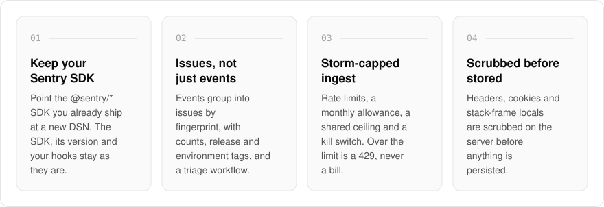
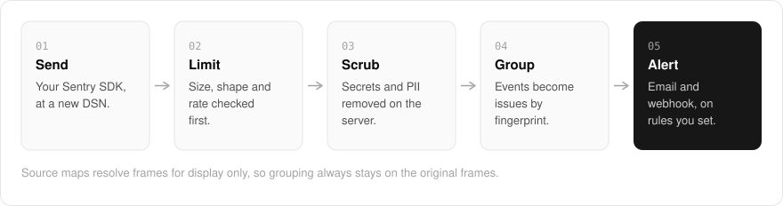

  <picture>
    <source media="(prefers-color-scheme: dark)" srcset=".github/assets/hero-dark.png">
    
  </picture>

<h1 align="center">fix.me.at</h1>

<strong>Error tracking without a new SDK.</strong>

  
  
  
  

  <a href="#features">Features</a> ·
  <a href="#how-it-works">How it works</a> ·
  <a href="#built-with">Built with</a>

Switching error trackers usually means ripping out one SDK and wiring in another. I built fix.me.at with a Sentry-SDK-compatible ingest endpoint, so you point the `@sentry/*` SDK you already ship at a different DSN, and the SDK, its version and every hook you have written stay exactly as they are. Errors are grouped into issues, ingest is storm-capped, and secrets and PII are scrubbed before anything is stored. It is for teams who want error tracking and nothing else.

  <picture>
    <source media="(prefers-color-scheme: dark)" srcset=".github/assets/overview-dark.svg">
    
  </picture>

## Why fix.me.at

| The usual error tracker | fix.me.at |
| --- | --- |
| A new SDK to install | The Sentry SDK you already ship, with a new DSN |
| A spike turns into an overage bill | A project over its limit gets 429s, with no overage price |
| Source maps can change how errors group | Source maps are a display overlay, and grouping stays on the original frames |
| Traces and spans kept whether you want them or not | Exceptions lifted out of OTLP data, spans never retained |

## Features

- **Speaks the Sentry SDK protocol**: the ingest endpoint accepts the Sentry envelope protocol at a pinned version, so moving over is a one-line DSN change per service. A new upstream SDK release cannot quietly change what ingest accepts.
- **Issues, not just events**: events are grouped into issues by fingerprint, with occurrence counts, release and environment tags, and a resolve, ignore and assign workflow.
- **Alert rules**: first occurrence, regression and threshold alerts, delivered to email and webhook.
- **One crashing client cannot flood the queue**: per-project rate limits, a monthly event allowance, a shared ceiling across tenants, and a per-project kill switch. Size and shape limits are checked before the request body is read, and a project over its limit gets 429s, with no overage price.
- **Scrub-then-store**: request headers, cookies and stack-frame locals are scrubbed on the server before anything is persisted. Events are kept for 30 days by default.
- **Source maps without changing grouping**: maps uploaded with `sentry-cli` resolve frames as a display overlay only. Fingerprints stay on the original frames, and a stack that cannot be fully resolved is shown as minified, labelled as such.
- **OTLP exception ingest**: OTLP logs and traces endpoints lift exceptions out of log records and span events; spans themselves are never retained.
- **Plain HTTP APIs and self-hosting**: issues, events, alert rules and usage meters are JSON over HTTP. Run it against Postgres, an S3-compatible bucket and Redis, or entirely in memory, with an offline license check that never calls home.

## How it works

  <picture>
    <source media="(prefers-color-scheme: dark)" srcset=".github/assets/flow-dark.svg">
    
  </picture>

Your existing Sentry SDK sends events to a new DSN. Size, shape and rate limits are checked before the request body is read, then headers, cookies and stack-frame locals are scrubbed on the server before anything is stored. Events are grouped into issues by fingerprint, and alert rules fire to email and webhook.

## Built with

  
  
  
  
  
  

- Next.js 16 (App Router), React 19, TypeScript
- Tailwind CSS 4
- Drizzle ORM with Postgres
- S3-compatible object storage for event payloads
- Better Auth
- next-intl

## Part of the me.at family

fix.me.at is one of my [`*.me.at`](https://me.at) apps. They share one design system, one account, and one app shell. Development happens in a private monorepo; this repository is the project's public-facing home.

## License

Source-available. See [LICENSE](LICENSE).
